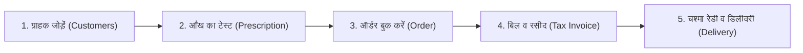

# 👓 SATGURU VISION CARE — आसान यूज़र गाइड व ऑपरेटिंग मैनुअल (SOP)

> **Opticians, Optometrists & Eyewear Clinic Management ERP**  
> 🌐 **Official Website Domain:** `satguruvisioncare.com`  
> 📄 **प्रिंट करने योग्य PDF फ़ाइल:** [`Satguru_Vision_Care_User_Manual.pdf`](file:///Users/chandankumar/Desktop/satguru%20vision%20care/Satguru_Vision_Care_User_Manual.pdf) (या लाइव डाउनलोड: `/Satguru_Vision_Care_User_Manual.pdf`)  
> यह डॉक्यूमेंट आपकी दुकान के रोज़मर्रा के काम (Daily Store Workflow) को आसान, व्यवस्थित और कम्प्यूटराइज़्ड बनाने के लिए तैयार किया गया है।

---

## 📑 विषय-सूची (Index)
1. [सॉफ्टवेयर में लॉगिन कैसे करें?](#1-सॉफ्टवेयर-में-लॉगिन-कैसे-करें)
2. [दुकान में नया ग्राहक आने पर पूरा प्रोसेस (5 आसान स्टेप्स)](#2-नया-ग्राहक-आने-पर-पूरा-प्रोसेस)
3. [पुराने ग्राहक का पिछला पावर और हिस्ट्री देखना](#3-पुराने-ग्राहक-का-पावर-और-हिस्ट्री-देखना)
4. [चश्मा और लेंस का ऑर्डर बुक करना](#4-चश्मा-और-लेंस-का-ऑर्डर-बुक-करना)
5. [पक्का बिल (Tax Invoice) और WhatsApp रसीद](#5-पक्का-बिल-और-whatsapp-रसीद)
6. [बाकी पेमेंट (Outstanding Balance) जमा करना](#6-बाकी-पेमेंट-जमा-करना)
7. [डिलीवरी और चेकअप का फॉलो-अप (Follow-ups)](#7-डिलीवरी-और-चेकअप-फॉलो-अप)
8. [स्टॉक और फ्रेम/लेंस इन्वेंटरी जोड़ना](#8-स्टॉक-और-इन्वेंटरी-मैनेजमेंट)
9. [दैनिक रिपोर्ट और हिसाब-किताब (Reports)](#9-दैनिक-रिपोर्ट-और-हिसाब)
10. [नया स्टाफ जोड़ना और उनके अधिकार (Staff & Permissions)](#10-स्टाफ-और-अनुमतियाँ)
11. [दुकान की सेटिंग्स, GST और बिल प्रिंटिंग](#11-स्टोर-सेटिंग्स-व-gst)
12. [अपना डोमेन (satguruvisioncare.com) लाइव कैसे जोड़ें?](#12-अपना-डोमेन-satguruvisioncarecom-लाइव-कैसे-जोड़ें)

---

## 1. सॉफ्टवेयर में लॉगिन कैसे करें?

1. ब्राउज़र में **`https://satguruvisioncare.com/login`** खोलें (लोकल टेस्टिंग के लिए `http://localhost:3000/login`)।
2. **Shop Owner (दुकान मालिक):**
   * **Name:** Sukhvender Singh
   * **Username:** `sukhbendarsingh`
   * **Password:** `sukh@4164`
   * **Email:** `sukh4164@gmail.com`
   * **Mobile:** `+91 98708 33033`
   * *अधिकार:* पूरी दुकान का नियंत्रण, दैनिक बिक्री/गल्ला, इन्वेंटरी, GST सेटिंग्स, और नया स्टाफ बनाना।
3. **Staff Accounts (कर्मचारी):**
   * दुकान मालिक **Staff Management** मेनू से अपने कर्मचारियों (सेल्समैन या ऑप्टोमेट्रिस्ट) के लिए अलग यूज़र आईडी और पासवर्ड कभी भी बना सकते हैं।

---

## 2. नया ग्राहक आने पर पूरा प्रोसेस (Daily Store Workflow)

जब भी कोई नया ग्राहक दुकान पर आता है, तो आपको यह आसान क्रम अपनाना है:

### स्टेप 1: ग्राहक का रजिस्ट्रेशन करें
1. हेडर में **`New Customer`** बटन पर क्लिक करें या साइडबार से **`Customers` ➔ `+ Add New Customer`** पर जाएँ (यह सीधे `/dashboard/customers/new` पेज खोलता है)।
2. ग्राहक की जानकारी भरें:
   * **नाम:** (उदा. *Rameshwar Patel*)
   * **मोबाइल नंबर (10 अंक):** (उदा. *9820012345*)
   * **DOB / Age:** जन्मतिथि डालते ही उम्र अपने आप आ जाएगी।
   * **पता / शहर:** (डिफ़ॉल्ट *Mumbai*)।
3. **स्मार्ट डुप्लीकेट अलर्ट:** यदि इस नंबर से पहले से कोई ग्राहक बना होगा, तो सॉफ्टवेयर तुरंत स्क्रीन पर बता देगा और उसका पुराना रिकॉर्ड दिखा देगा।
4. नीचे **`Register & Add Eye Prescription (Rx)`** बटन दबाएँ। ग्राहक सेव होते ही सीधे आई-टेस्टिंग पेज खुल जाएगा!

---

## 3. आँख का टेस्ट (Eye Prescription) दर्ज करना

आई-टेस्टिंग रूम में ऑप्टोमेट्रिस्ट तुरंत ग्राहक की दोनों आँखों का पावर भरेंगे:

1. **Right Eye (OD - दायाँ आँख):**
   * `SPH` (Spherical), `CYL` (Cylindrical), `AXIS` (0° से 180°), `ADD` (बाइफोकल/प्रोग्रेसिव के लिए), `PD` (Pupillary Distance)
2. **Left Eye (OS - बायाँ आँख):**
   * `SPH`, `CYL`, `AXIS`, `ADD`, `PD`
3. **Prescription Type चुनें:**
   * Distance Vision (दूर का चश्मा)
   * Reading / Near Vision (पास का चश्मा)
   * Bifocal / Progressive (धूप-छांव या दोनों दूरी)
   * Computer Glasses (ब्लू कट)
4. **डॉक्टर का नाम व अगला चेकअप:** अगली जाँच की तारीख (उदा. 6 महीने बाद) दर्ज करें। सॉफ्टवेयर उस तारीख का रिमाइंडर अपने आप बना देगा।
5. **Print Rx:** टेस्ट पूरा होने पर डॉक्टर स्लिप को प्रिंट किया जा सकता है या ग्राहक को WhatsApp भेजा जा सकता है।

---

## 4. पुराने ग्राहक का पावर और हिस्ट्री देखना

जब कोई पुराना ग्राहक 6 महीने या 1 साल बाद वापस आता है:

1. ऊपर सर्च बार में उसका **नाम या मोबाइल नंबर** टाइप करें।
2. उसकी प्रोफाइल खुलते ही आपको स्क्रीन पर दिखेगा:
   * **Total Records:** उसने आज तक कितनी बार आँखें चेक करवाई हैं (उदा. *3 Tests Records*)।
   * **Last Checkup Date:** पिछली बार किस तारीख को टेस्ट हुआ था।
   * **Power Comparison (तुलना कार्ड):** दाएँ और बाएँ आँख का पिछला पावर और नया पावर आमने-सामने दिखेगा। यदि पावर में कोई बदलाव हुआ है (जैसे SPH -1.00 से -1.50 हुआ), तो सिस्टम उसे खुद हाइलाइट कर देगा।
   * **सभी पुराने टेस्टों की सूची (#1, #2, #3):** हर टेस्ट की पूरी डिटेल कभी भी एक क्लिक में देखी जा सकती है।

---

## 5. चश्मा और लेंस का ऑर्डर बुक करना

1. साइडबार में **`Orders` ➔ `+ New Order`** पर क्लिक करें।
2. **Customer & Prescription चुनें:** ग्राहक और उसका लेटेस्ट टेस्ट सेलेक्ट करें।
3. **फ्रेम की डिटेल:**
   * दुकान के इन्वेंटरी स्टॉक में से फ्रेम चुनें (जैसे *Ray-Ban Aviator*) या कस्टम नाम लिखें।
   * *फायदा:* इन्वेंटरी से चुनने पर स्टॉक में से 1 पीस अपने आप कम हो जाएगा!
4. **लेंस की डिटेल:** (उदा. *Crizal Anti-Glare Blue UV 1.56 Pair*)।
5. **अमाउंट व डिस्काउंट:**
   * फ्रेम व लेंस की कीमत डालें।
   * यदि डिस्काउंट देना है तो डिस्काउंट डालें।
   * GST (12% या 18%) अपने आप कैलकुलेट हो जाएगा।
6. **एडवांस पेमेंट (Advance Paid):** ग्राहक ने जितने रुपये जमा किए (Cash, UPI, Card), वो डालें। बाकी बैलेंस खुद-ब-खुद निकल आएगा।
7. **डिलीवरी डेट:** चश्मा कब तैयार होकर मिलेगा (उदा. 3 दिन बाद)।
8. **`Create Order & Generate Invoice`** पर क्लिक करें।

---

## 6. पक्का बिल (Tax Invoice) और WhatsApp रसीद

ऑर्डर बनते ही सिस्टम तुरंत **जीएसटी टैक्स इनवॉइस** बना देता है:

1. इनवॉइस में आपकी दुकान का **असली SV लोगो**, दुकान का पता, GSTIN और **`satguruvisioncare.com`** प्रिंट होता है।
2. **1-Click WhatsApp:** **`Send Invoice on WhatsApp`** बटन दबाते ही कस्टमर के WhatsApp पर बिल नंबर, कुल अमाउंट, जमा एडवांस और बाकी बैलेंस का फॉर्मेटेड मैसेज चला जाता है।
3. **Print:** पक्का A4 या थर्मल रसीद प्रिंटर से 1-क्लिक में बिल निकालें।

---

## 7. बाकी पेमेंट (Outstanding Balance) जमा करना

जब ग्राहक चश्मा लेने आता है और बाकी पैसा देता है:

1. साइडबार में **`Payments` ➔ `+ Record Payment`** पर क्लिक करें (या सीधे कस्टमर प्रोफाइल से पेमेंट लें)।
2. इनवॉइस या ऑर्डर सेलेक्ट करें (बाकी बैलेंस स्क्रीन पर दिख जाएगा)।
3. जमा की गई राशि और माध्यम (Cash / GPay / PhonePe / Card) चुनें।
4. **Save** करते ही:
   * इनवॉइस का स्टेटस **Paid** हो जाएगा।
   * तुरंत पेमेंट रसीद जनरेट हो जाएगी।

---

## 8. डिलीवरी और चेकअप का फॉलो-अप (Follow-ups)

1. साइडबार में **`Follow-ups & Recalls`** पर जाएँ:
   * **Delivery Ready:** जो चश्मे तैयार हो चुके हैं, उनकी लिस्ट।
   * **Pending Balance:** जिन ग्राहकों का पैसा बाकी है, उनके कॉल रिमाइंडर्स।
   * **Eye Checkup Due:** जिन ग्राहकों का 6 महीने या 1 साल पुराना चेकअप पूरा हो चुका है, उन्हें दोबारा बुलाने के लिए रिमाइंडर।
2. काम पूरा होने पर **`Mark Completed`** पर क्लिक करें।

---

## 9. स्टॉक और इन्वेंटरी मैनेजमेंट (Products & Stock)

1. साइडबार में **`Products & Stock`** पर जाएँ:
   * यहाँ फ्रेम्स, सनग्लासेस, लेंस और कॉन्टैक्ट लेंस की लिस्ट दिखेगी।
2. **नया प्रोडक्ट जोड़ें (`+ Add Product`):**
   * ब्रांड (Ray-Ban, Fastrack, Titan, Generic)
   * मॉडल नंबर / बारकोड
   * खरीद मूल्य (Purchase Price) और बिक्री मूल्य (Selling Price)
   * कुल स्टॉक क्वांटिटी और **Min Stock Alert** (उदा. 3 पीस)।
3. **कम स्टॉक अलर्ट:** जब भी किसी फ्रेम का स्टॉक कम होगा, तो डैशबोर्ड पर लाल रंग में चेतावनी दिखेगी ताकि आप सप्लायर से नया माल मँगवा सकें।

---

## 10. दैनिक रिपोर्ट और हिसाब (Reports & Analytics)

*यह सेक्शन केवल **Admin (मालिक)** को दिखाई देता है:*

1. **आज की कुल बिक्री (Today's Sales):** आज कितने रुपये का गल्ला हुआ।
2. **महीने और साल का टर्नओवर:** पूरे महीने और साल की कुल आय।
3. **कुल मार्केट में बाकी (Total Outstanding):** ग्राहकों के पास कुल कितना पैसा फंसा हुआ है।
4. **देनदारों की लिस्ट (Top Debtors):** किन-किन ग्राहकों पर कितना बकाया है और उनके फोन नंबर।
5. **स्टाफ का प्रदर्शन (Staff Performance):** किस कर्मचारी ने आज कितने कस्टमर जोड़े, कितने टेस्ट किए और कितने ऑर्डर बुक किए।

---

## 11. स्टाफ और अनुमतियाँ (Roles & Permissions)

1. **`Staff Management`:**
   * नए कर्मचारियों (सेल्समैन या ऑप्टोमेट्रिस्ट) के लिए अलग यूजर आईडी और पासवर्ड बनाएँ।
2. **`Roles & Permissions`:**
   * आप तय कर सकते हैं कि कौन सा कर्मचारी क्या देख सकता है:
     * क्या कर्मचारी कुल कमाई (Revenue) देख सकता है? (हाँ / ना)
     * क्या कर्मचारी पुराना बिल डिलीट कर सकता है? (हाँ / ना)
     * क्या कर्मचारी डिस्काउंट दे सकता है?

---

## 12. अपना डोमेन (satguruvisioncare.com) लाइव कैसे जोड़ें?

आपकी वेबसाइट और Turso क्लाउड डेटाबेस पूरी तरह तैयार हैं। जब आप अपनी वेबसाइट को लाइव (Vercel या Cloudflare Pages) पर होस्ट करेंगे:

### स्टेप A: Vercel / Cloudflare पर डिप्लॉय करना
1. अपने GitHub अकाउंट में यह कोड पुश करें।
2. Vercel या Cloudflare Pages पर **Import Project** करें।
3. **Environment Variables** में ये 2 वैल्यू सेट करें:
   * `TURSO_DATABASE_URL`: `libsql://satguru-vision-sukhvendersingh.aws-ap-south-1.turso.io`
   * `TURSO_AUTH_TOKEN`: `eyJhbGciOiJFZ...` (आपकी Turso की टोकन)
4. Deploy पर क्लिक करें।

### स्टेप B: DNS रिकॉर्ड्स सेट करना (GoDaddy / Namecheap / Hostinger पर):
जहाँ से आपने `satguruvisioncare.com` खरीदा है (जैसे GoDaddy या Hostinger), उसके **DNS Management** में जाएँ और ये 2 रिकॉर्ड जोड़ें:

| Type | Name (Host) | Value / Target | TTL |
| :--- | :--- | :--- | :--- |
| **A Record** | `@` | `76.76.21.21` (यदि Vercel पर है) | Automatic / 3600 |
| **CNAME** | `www` | `cname.vercel-dns.com` (या Cloudflare Pages CNAME) | Automatic |

*नोट: रिकॉर्ड्स सेव करने के 15-30 मिनट में आपका डोमेन **`https://satguruvisioncare.com`** फ्री SSL (Green Lock 🔒) के साथ एक्टिव हो जाएगा!*

---

### 📞 त्वरित सहायता या शॉर्टकट चीट-शीट:

| काम | कहाँ क्लिक करें? |
| :--- | :--- |
| **नया कस्टमर जोड़ना** | ऊपर हेडर में `New Customer` बटन |
| **नया टेस्ट दर्ज करना** | ऊपर हेडर में `+ Add Prescription` बटन |
| **नया चश्मा ऑर्डर बुक करना** | साइडबार में `Orders` ➔ `+ New Order` |
| **पुराना रिकॉर्ड खोजना** | सबसे ऊपर सर्च बार में मोबाइल नंबर डालें |
| **आज की कमाई देखना** | साइडबार में `Reports & Analytics` |
| **दुकान सेटिंग्स व डोमेन** | साइडबार में `Store Settings` |
| **लॉगआउट करना** | साइडबार में नीचे बाएँ `Log Out` बटन |

---
*दस्तावेज़ संस्करण 1.2 • Satguru Vision Care ERP System*  
📍 **दुकान का पता:** Delhi gate, Aligarh, Uttar Pradesh - 202001  
👤 **मालिक:** Sukhvender Singh (+91 98708 33033 | sukh4164@gmail.com)  
🌐 **वेबसाइट:** [satguruvisioncare.com](https://satguruvisioncare.com)
